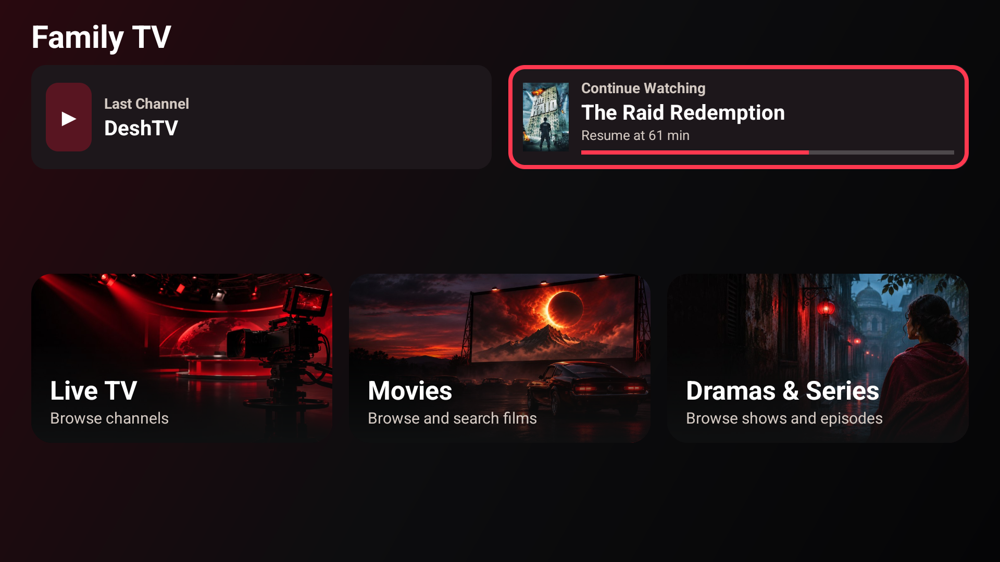
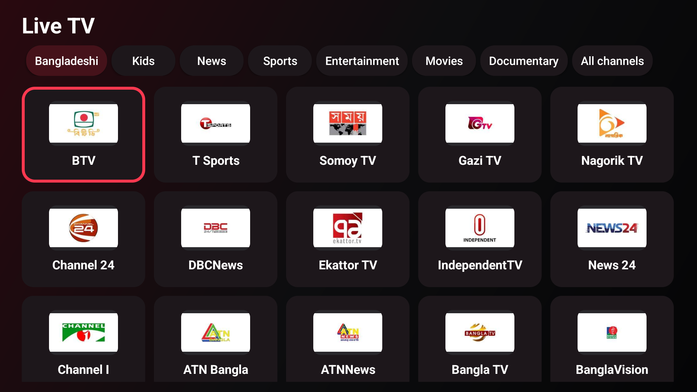
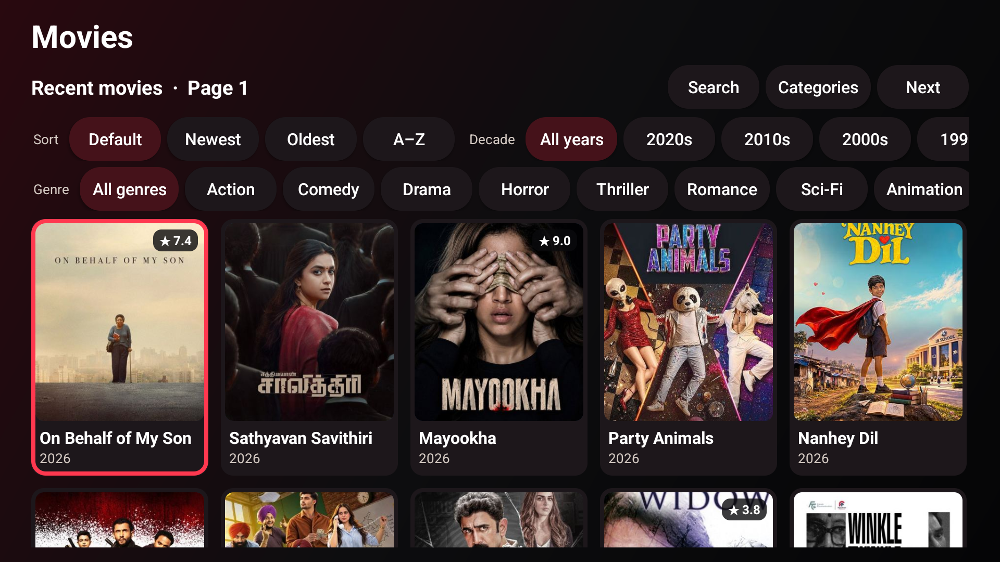
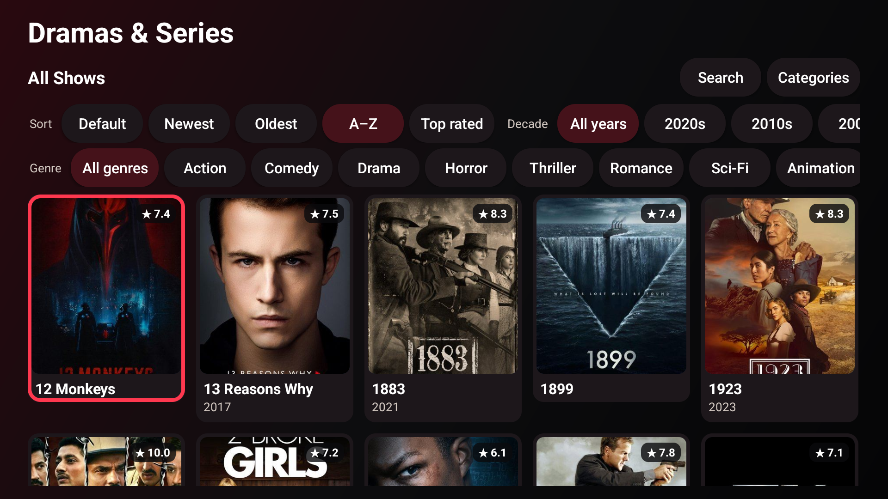

# Family TV

A lightweight, high-performance native Android TV (Leanback) application built for household media portals and public-domain streaming. It uses native Android views and Media3 ExoPlayer for seamless video playback.

---

## ✨ Features

- **Live TV**: Combines local ISP/BDIX live streams (BuddyTV, Zflix) with open HTTPS internet channels from `iptv-org`. Supports categories (Kids, News, Sports, Entertainment, Movies, Documentary) and automatic fallback streams.
- **Movies**: Aggregates movie listings from local ISP servers, Mazeda FTP, and free public-domain feature films from the **Internet Archive**. Includes search suggestions, sorting (Newest, Oldest, A–Z, Top Rated), and decade/genre filters.
- **Dramas & Series**: Browses collection folders and multi-season TV shows with automatic season/episode parsing.
- **TMDB Enrichment**: Automatically fetches genres, ratings, and posters from The Movie Database (TMDB).
- **Resume & Cache**: Remembers playback position for recent media and caches artwork/metadata efficiently on disk.
- **Zero Bloat**: No ads, tracking, accounts, or analytics.

---

## 📸 Screenshots

| Home Screen | Live TV |
| :---: | :---: |
|  |  |

| Movies Catalogue | Dramas & Series |
| :---: | :---: |
|  |  |

| Video Player & Overlay | |
| :---: | :---: |
|  | |

---

## 🌐 Network Configuration & ISP Portals

Out of the box, Family TV works on any internet connection using public sources (`iptv-org` and Internet Archive). 

If your ISP provides internal local network (BDIX) media portals, you can configure your server endpoints in `app/src/main/java/local/familytv/ServerConfig.kt`:

```kotlin
object ServerConfig {
    var tmdbApiKey: String = "YOUR_TMDB_API_KEY"
    var enableLocalIspSources: Boolean = true
    var buddyTvHost: String = "http://YOUR_BUDDY_TV_IP/"
    var zflixHost: String = "http://YOUR_ZFLIX_DOMAIN"
    var moviesHost: String = "YOUR_MOVIES_IP"
    var mazedaApiHost: String = "http://YOUR_MAZEDA_IP/api/"
}
```

If you do not have local ISP servers, you can set `enableLocalIspSources = false` to run exclusively on public internet sources.

---

## 🤖 AI Agent Setup Prompt (`AI_SETUP.md`)

If you are using an AI coding assistant (such as OpenCode, Cursor, or Claude Code), you can give it this prompt to automatically configure your ISP endpoints:

> *"I want to configure Family TV for my home network. Here are my ISP media server endpoints: [Insert your URLs/IPs here]. Please update `ServerConfig.kt` to use these servers and adjust any scrapers accordingly."*

---

## 🛠️ Build and Requirements

- **JDK:** 17
- **Gradle:** 8.9+
- **Android SDK API:** 35 (Target & Compile), Min SDK 28

To build debug APK:
```bash
gradle assembleDebug
```
The resulting APK will be located at `app/build/outputs/apk/debug/app-debug.apk`.

---

## 📜 License

This project is open-source software. Feel free to fork, adapt, and improve for your household.
